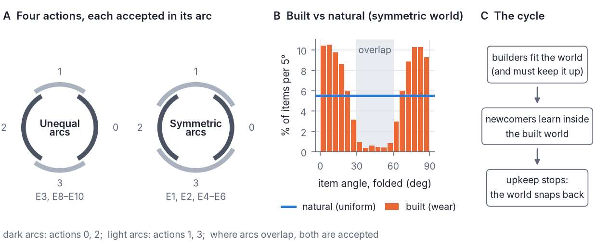

# Fitting the World to the Model: What It Costs, and Who It Serves

**[Read the paper (PDF)](paper/preprint.pdf)** · [One-page summary (PDF)](paper/summary.pdf) · [Preregistration](PREREGISTRATION.md) · [Report](REPORT.md)

<!-- DOI badge: add after the Zenodo release, e.g. [](https://doi.org/10.5281/zenodo.XXXXXXX) -->



**Figure 1.** **The world.** (A) Items sit on a ring, and four actions are each accepted inside an arc. Experiments use one of two geometries: symmetric arcs (±60°), where neighbouring arcs overlap by 30° and a third of the ring is accepted by two actions; and unequal arcs (±60° for actions 0 and 2, ±35° for actions 1 and 3). (B) Building empties the overlap. Share of items per 5° bin, folded onto 0–90°, in a world kept up by wear (symmetric arcs; mean of 10 worlds), against the uniform natural world. (C) The cycle studied: builders fit the world and keep it up; newcomers learn inside it; when upkeep stops, items drift back home.

## What we found

1. **Upkeep.** How much gets built follows a simple rule: the number of builders, times how hard each pushes, divided by how fast things drift back. When the builders stop, it fades. Bigger networks for the builders (within the sizes tested) didn't change it.
2. **Built for one kind of reader.** A reshaped world is much simpler for readers built like the builders than for outsiders: almost all of the simplification disappears for an outsider. Some of the benefit is shared by everyone, but most of the structure is readable only with the builders' "key". In short, the reshaped world stays useful to outsiders but illegible to them.
3. **Newcomers don't learn what the world no longer shows.** Agents who already knew the world kept what they knew when they moved into a reshaped one, though they largely stopped improving. But anyone learning inside it, from scratch or halfway, failed to pick up what reshaping had removed.
4. **A quiet trap.** Agents raised in a reshaped world feel *less* surprised at home than agents raised in the untouched world. Yet beyond the reshaped region they are confidently wrong about two to four times as often. When upkeep stopped and the world snapped back, they earned 42–73% less. Much of this is because reshaping removes the hard cases near the edge, so nobody raised there meets them; learners who test themselves just past their edge find nothing there to correct them.

## Reproduce

The commands from the paper's section 7 (`runs/run.py e10_outsider` is the exploratory D5 task, added after the frozen code):

```
bash runs/stage2_tuning.sh
bash runs/stage2_smoke.sh
python runs/run.py e1 0-9
bash runs/stage3.sh
bash runs/stage4.sh
python runs/run.py e10_outsider 0-9
```

Then the analysis scripts, including `analysis/e10_extra.py` for D5, the ε_min extras and the absolute confident-error rates; the full sequence, with the figure and PDF builds, is under "Reproducing" below. The whole study runs in a few hours on a 16-core desktop CPU, with no GPU.

## About this repository

Code, preregistration, results and paper for a small simulation study of **persistent world-fitting**: learning agents that reshape their world to suit what they already do, and what that costs in upkeep, readability and newcomers' learning.

- **Paper:** `paper/preprint.pdf` (source `paper/preprint.md`); one-page summary `paper/summary.pdf` (source `paper/summary.md`).
- **Preregistration:** `PREREGISTRATION.md`, committed before any real run (commit `47da90e`); frozen settings in its section 11 (`1433ed6`); frozen code `404476d`. The repository was private until this preprint was released, so these commit times rest on the author's local record; before release the history was rewritten only to change the author name and remove local working files (HISTORY.md). Deviations are logged in `DEVIATIONS.md` (D1–D5).
- **Full results:** `REPORT.md`, one row per preregistered prediction, with the command that regenerates each number.

## Requirements

Python 3.12 on any OS; CPU only, no GPU.

```
pip install -r requirements.txt
```

`torch` is used only for the representational-similarity measure (`src/metrics.py`); a CPU build is enough. `pypandoc_binary` and `typst` are needed only to rebuild the paper. `python tools/get_fonts.py` fetches the two fonts it uses (Inter and Source Serif 4, both under the SIL Open Font License) into `paper/typst/fonts/`; the figures use Inter too. `python paper/render_typst.py` then builds `preprint.pdf` and `summary.pdf`. `paper/render.py` is the HTML fallback: it writes `preprint.html`, and its PDF step (`preprint_html.pdf`) uses a local Chromium-based browser (Microsoft Edge on Windows).

## Layout

- **`src/world.py`:** the world, agents and measures (numba).
- **`src/exps.py`, `src/config.py`:** experiment tasks and frozen settings.
- **`src/metrics.py`:** representational similarity (E_K), copied unchanged from an earlier project at the commit noted in its header.
- **`runs/run.py`:** parallel, resumable runner (one result file per task, merged into CSVs).
- **`runs/*.sh`:** stage scripts.
- **`analysis/`:** one script per experiment. `analysis/figures/make_figures.py` draws every figure.
- **`results/`:** merged result tables (CSV) and analysis outputs.
- **`paper/`:**
  - `preprint.md`, `summary.md` and `figures/` (PNG, SVG);
  - `render_typst.py` builds the PDFs with Typst, using the design in `typst/` (`style.typ`, `template.typ`, and `preprint.lua`, a pandoc filter that changes layout only);
  - `render.py` builds the HTML fallback;
  - `verify_numbers.py` checks every reported number against `results/`.
- **`tests/`:** unit tests for the world (`test_world.py`) and an end-to-end smoke check of every task (`test_exps_quick.py`).
- **`pilot*/`, `PILOT*.md`:** the six design pilots (design checks, not evidence).
- **Design history:** `BRIEF.md`, `PLAN.md`, `REVIEW_1.md`, `CHECKIN_3.md`, `LOG.md`.

## Reproducing

```
bash runs/stage2_tuning.sh          # tuning and sanity checks (seeds 7000-7099)
bash runs/stage2_smoke.sh           # smoke test, seed 7010
python runs/run.py e1 0-9           # E1
bash runs/stage3.sh                 # E10 (with E9), E8
bash runs/stage4.sh                 # E2-E6, E8 fixed-pretraining arm, matched rerun
python runs/run.py e10_outsider 0-9 # D5 (exploratory); task added after the frozen code, commit 62af047
python analysis/e10.py; python analysis/e8.py; python analysis/e8.py e8_fixed
python analysis/e2.py; python analysis/e3.py; python analysis/e4.py; python analysis/e10_matched_v2.py
python analysis/e10_extra.py        # D5, eps_min extras, absolute confident-error rates (post hoc)
python tools/get_fonts.py           # fonts for the figures and the PDF build (once)
python analysis/figures/make_figures.py
python paper/verify_numbers.py
python paper/render_typst.py        # preprint.pdf, summary.pdf
python paper/render.py              # HTML fallback: preprint.html
python -m pytest tests/test_world.py
```

The whole study takes a few hours on a 16-core desktop CPU. `env.sh` sets cache directories inside the repository; adapt its interpreter path to your environment.

## Licences

- **Code:** MIT (`LICENSE`).
- **Text, figures and documents:** CC BY 4.0 (`LICENSE-text.md`).

## Guide to the notes

- **`BRIEF.md`:** the frozen experiment brief (version 7.2).
- **`BRIEF_v2_OLD.md`:** version 2 of the brief, kept for reference because version 7.2 cites parts of it.
- **`PLAN.md`:** the implementation plan, as amended by REVIEW_1.md.
- **`PILOT*.md`:** the six design pilots: each pilot's spec (written before its code), log and report. Design checks, not evidence.
- **`REVIEW_1.md`:** the author's decisions on PLAN.md before the preregistration.
- **`CHECKIN_3.md`:** the stage-3 check-in on E8, E9 and E10.
- **`LOG.md`:** a running log of what was run, why, and what happened.
- **`DEVIATIONS.md`:** every deviation from the preregistration, logged before the runs it affects (D1–D5).
- **`REPORT.md`:** the full results, one row per preregistered prediction, with the command that regenerates each number.
- **`HISTORY.md`:** how the git history was prepared for publication, with a table from old to new commit hashes.

*Neon*, in the briefs and pilot notes, is the name used for an AI model that reviewed the briefs and drafts; the experiments were run by Claude Code (Anthropic) under the author's direction.

## How to cite

Citation metadata is in [`CITATION.cff`](CITATION.cff) (GitHub shows a "Cite this repository" button for it). The DOI will be added at the Zenodo release.

David Shen (2026). *Fitting the World to the Model: What It Costs, and Who It Serves.* Preprint. [DOI to be added at the Zenodo release.]
